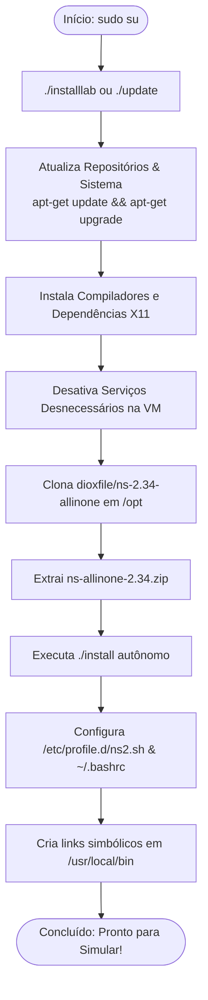

<div align="center">

# 🌐 LabInstall — NS-2.34 All-in-One com OLSR no Debian

> **Instalador automatizado e livre de erros para o Network Simulator 2 (NS-2.34) com suporte nativo ao protocolo UM-OLSR no Debian GNU/Linux.**

[](https://www.debian.org)
[](https://www.nsnam.org)
[](https://github.com/dioxfile/ns-2.34-allinone)
[](https://www.gnu.org/software/bash/)
[]()

<br/>

[Visão Geral](#-visão-geral) •
[Início Rápido](#-início-rápido) •
[O que é Instalado](#-o-que-é-instalado) •
[Fluxo de Execução](#-fluxo-de-execução) •
[Testes de Validação](#-testes-de-validação) •
[Créditos](#-créditos)

</div>

---

## 📖 Visão Geral

Compilar o **NS-2.34** em distribuições modernas do Linux costuma gerar inúmeros conflitos de cabeçalhos C++, compatibilidade com GCC recente e bibliotecas gráficas legadas (X11/Tcl/Tk). 

O **LabInstall** resolve isso de ponta a ponta:
- Atualiza o sistema Debian.
- Prepara todo o ferramental de compilação e dependências de ambiente.
- Baixa a versão patched e testada **[dioxfile/ns-2.34-allinone](https://github.com/dioxfile/ns-2.34-allinone)** (que já integra o protocolo **UM-OLSR**).
- Extrai, compila e instala todos os módulos de forma 100% autônoma.
- Injeta as variáveis de ambiente (`PATH`, `LD_LIBRARY_PATH`, `TCL_LIBRARY`) tanto a nível de sistema (`/etc/profile.d/ns2.sh`) quanto nos arquivos `.bashrc`, além de criar links simbólicos em `/usr/local/bin` para uso imediato.

---

## ⚡ Início Rápido

### 1. Obter privilégios de Administrador
No terminal do seu Debian, torne-se superusuário:
```bash
sudo su
```

### 2. Clonar o repositório
```bash
git clone https://github.com/danielsoares15/labinstall.git
cd labinstall
```

### 3. Conceder permissão e executar
```bash
chmod +x installlab update
./installlab
```
> *(Você também pode executar diretamente `./update`, ambos funcionam perfeitamente como root).*

---

## 📦 O que é Instalado e Configurado

| Categoria | Pacotes / Componentes |
| :--- | :--- |
| **Simulador Principal** | NS-2.34 (com protocolo UM-OLSR integrado) |
| **Interface & Animação** | NAM (Network Animator 1.14 / 1.13), XGraph |
| **Componentes All-in-One** | Tcl (8.4.18), Tk (8.4.18), OTcl (1.13), TclCL (1.19) |
| **Compiladores & Build** | `build-essential`, `gcc`, `g++`, `make`, `autoconf`, `automake`, `patch`, `libtool` |
| **Bibliotecas X11/GUI** | `libx11-dev`, `libxmu-dev`, `libxmu-headers`, `libxt-dev`, `libxext-dev`, `xorg-dev` |
| **Ferramentas de Rede** | `net-tools` (`ifconfig`), `wireshark`, `tshark`, `nmap`, `subnetcalc`, `openssh-server` |
| **Ambiente de Desenvolvimento** | `geany`, `default-jdk`, `default-jre`, `git`, `curl`, `wget`, `unzip` |

---

## 🔄 Fluxo de Execução



---

## 🧪 Testes de Validação

Após a finalização do script, seu ambiente estará 100% pronto. Você pode validar a instalação com os testes abaixo:

### 1. Testar o console interativo do NS-2
```bash
ns
```
*Se a instalação foi bem-sucedida, você verá o prompt interativo `%`. Digite `exit` para sair.*

### 2. Testar o Network Animator (NAM)
```bash
nam
```
*A janela gráfica do NAM será aberta na sua área de trabalho.*

### 3. Rodar simulação real com protocolo OLSR
O pacote traz cenários de exemplo prontos para execução em `/opt/ns-2.34-allinone`:
```bash
cd /opt/ns-2.34-allinone
ns normalEnviroment_CBR.tcl
```

Cenários de teste disponíveis no diretório:
- `normalEnviroment_CBR.tcl`: Simulação com tráfego CBR e roteamento OLSR.
- `PM_10n_600xy.tcl`: Modelo de mobilidade com 10 nós.
- `D_cbrTraf4.tcl`: Padrão de geração de tráfego de dados.

---

## 📁 Estrutura do Repositório

```text
labinstall/
├── installlab      # Script de inicialização / bootstrap (validação de root e despacho)
├── update          # Script orquestrador de instalação, build e injeção de variáveis
└── README.md       # Documentação detalhada e estilizada do projeto
```

---

## ⚙️ Variáveis de Ambiente Criadas

As configurações são gravadas globalmente em `/etc/profile.d/ns2.sh`:

```bash
export NS_HOME="/opt/ns-2.34-allinone/ns-allinone-2.34"
export PATH="$PATH:$NS_HOME/bin:$NS_HOME/tcl8.4.18/unix:$NS_HOME/tk8.4.18/unix:$NS_HOME/ns-2.34:$NS_HOME/nam-1.14"
export LD_LIBRARY_PATH="$LD_LIBRARY_PATH:$NS_HOME/otcl-1.13:$NS_HOME/lib:/usr/X11R6/lib:/usr/local/lib"
export TCL_LIBRARY="$TCL_LIBRARY:$NS_HOME/tcl8.4.18/library:/usr/lib"
```

---

## 🤝 Créditos e Referências

- **NS-2 & NAM**: The VINT Project / nsnam ([nsnam.org](https://www.nsnam.org))
- **Pacote Corrigido & OLSR**: [dioxfile/ns-2.34-allinone](https://github.com/dioxfile/ns-2.34-allinone)
- **Protocolo UM-OLSR**: Desenvolvido por Francisco J. Ros (Universidade de Murcia).
- **Mantenedor do LabInstall**: [danielsoares15](https://github.com/danielsoares15)
